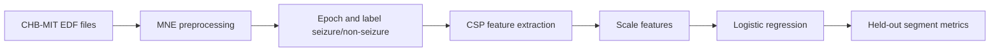

# EEG Seizure Detection

A CHB-MIT notebook experiment using EEG preprocessing, epoching, CSP features, and logistic regression to separate seizure from non-seizure segments.

## Results

The notebook contains saved outputs; they were not rerun locally. Its 1,790-example test set contains only **22 seizure-positive examples**.

| Notebook run | Accuracy | Seizure precision | Seizure recall |
|---|---:|---:|---:|
| First reported classifier | 92% | 0.10 | 0.68 |
| Second reported classifier | 96% | 0.16 | 0.59 |

Those accuracy values are misleading if read alone: most test examples are non-seizure, and seizure precision remains low. Do not describe this as a reliable detector.

## Architecture

## Quickstart and verification

The notebook includes Colab-era outputs and installation cells, but no standalone runner. The data is external and this notebook was not executed in the local review. Open `seizure_detection.ipynb` in a compatible notebook environment, install `requirements.txt`, and follow its CHB-MIT download/setup cells; this is not a locally verified one-command run.

## Limitations

- Strong class imbalance and very low seizure precision.
- Segment-level scores do not quantify event sensitivity, warning time, or false alarms per hour.
- Notebook outputs may depend on the historical Colab environment and dataset paths.
- No prospective, patient-independent, or real-time validation is reported.

## Next steps

1. Add patient-wise splits and compare against an always-negative baseline.
2. Report event-level sensitivity, false alarms/hour, and detection delay.
3. Pin dependencies and provide a small test fixture or deterministic preprocessing test.
4. Avoid clinical language until external validation is completed.
